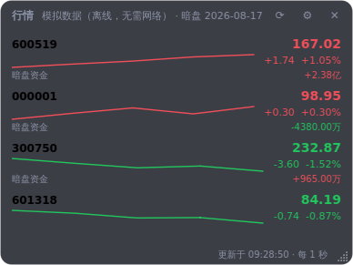
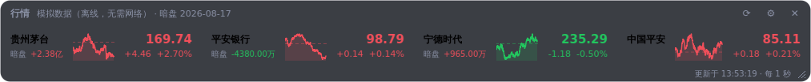
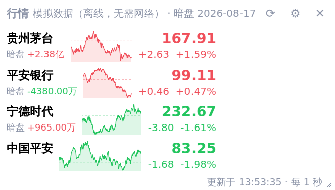
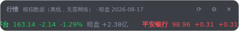
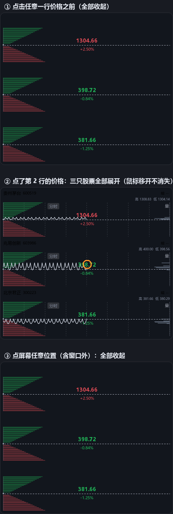
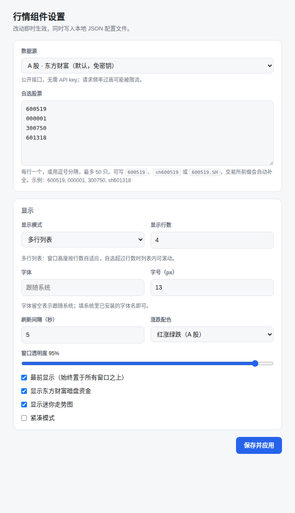

# A 股行情桌面组件 · Stock Ticker Widget

一款面向 A 股盯盘场景的轻量桌面悬浮组件，在不占用完整交易终端的情况下，持续展示
自选股现价、涨跌幅、当日分时走势和暗盘资金。支持经典网格、千档竖列和分时＋TDW 三套主题，
可查看千档挂单、成交量分布、B/S 波动点与日 K。窗口支持透明悬浮、鼠标穿透、自由缩放与
多种平铺方式，适合放在行情软件、浏览器或办公窗口上方作为常驻信息条。



## 项目简介

Stock Ticker Widget 使用 Python、PySide6 和 Flask 构建，由桌面悬浮窗、本地 WebUI 设置页
和后台行情轮询三部分组成。用户可以维护自选股列表，并针对股票名称、股价、涨跌幅、暗盘、
走势图、窗口透明度和布局方式进行细粒度定制；设置修改后立即同步到悬浮窗，同时写入本地
JSON 配置。各主题分别保存外观、窗口位置、尺寸和缩放比例，切换互不覆盖，
下次启动继续使用上次的主题和桌面布局。

项目内置东方财富、腾讯和新浪三个公开行情源，自动模式会在数据源不可用时依次降级；
分时数据以东方财富为主、腾讯为兜底，暗盘数据来自东方财富灰盘排行接口。这些公开行情接口
均无需 API key；可选的 `gupiao_ztfx` MCP 连接提供实时提醒、千档深度和当日 B/S 信号，
需要单独配置网关与 API Key。另提供 `mock` 模拟行情源，方便调试界面与配置。

项目以低干扰和高可定制为核心：既可以显示为多行行情网格，也可以压缩为一条横向行情带
或单行滚动信息流；背景可以完全透明，文字字号、颜色和字重可分别设置，并随窗口拖拽按既定
比例缩放。适合个人投资者日常盯盘，也可以作为 PySide6 桌面组件、实时数据轮询和本地 WebUI
联动的参考实现。

## 特性

- **悬浮小窗**：无边框 + 半透明圆角卡片，行情内容区可直接拖动，右下角可同时调整宽高
- **最前显示**：可开关，开启后始终置于所有窗口之上
- **WebUI 设置**：所有参数在浏览器里改，改完立刻下发到桌面窗口并写入 JSON
- **按行数平铺**：设几行就铺几行，股票依次向右排开——设 1 行就是一条横向行情带，窗口尺寸自适应
- **经典主题两种显示模式**：网格平铺 / 单行横向滚动（鼠标悬停暂停）
- **双主题切换**：主题 1 保留经典网格 / 单行滚动；主题 2 固定一列展示千档，支持左右镜像停靠
- **主题 2 全列表展开**：点击任意股票价格，所有股票一起展开详情和图表；可开启「始终展开」，重启后继续保持
- **分时 / 日 K 切换**：主题 2 提供图表点击切换，建议配合始终展开使用；日 K 按需异步加载最近 60 根，取数不阻塞窗口
- **千档深度与成交量分布**：通过 MCP 获取千档，失败按十档、五档降级，优先显示新盘口；全部取数失败时保留旧千档并标注缓存，连续失败提示 `ERROR`
- **三主题独立记忆**：字号、颜色、透明度、显示开关与窗口布局各存一份，自选和数据源等运行配置共用
- **字体独立设置**：股票名称、股价、涨跌幅和暗盘可分别设置字号、颜色、跟随涨跌及加粗
- **拖拽缩放**：拖右下角调整窗口宽高，内部行情按已设定的字体比例统一缩放和自适应重排
- **背景可调**：背景颜色和不透明度独立于窗口透明度，可以调到完全透明只留文字
- **鼠标穿透**：开启后点击直接落到下层程序，只在左上角留一个可拖动的小把手
- **按钮可隐藏**：关掉右上角的刷新 / 设置 / 灰度 / 退出后整条标题栏收起，只剩行情内容；组件上点右键随时能唤出同一批动作
- **数据源自动选择**：默认按东财 → 腾讯 → 新浪自动挑一个能用的并记住它，也可手动指定
- **自选股搜索**：输入代码、名称、完整拼音或首字母（如 `zhaoyichuangxin` / `zycx`）即可搜到并加进列表，可排序删除；优先腾讯搜索、东方财富备用，自动记住可用源，两个接口都不可用时仍可输入 6 位代码添加
- **每股显示开关**：设置页「自选股票」中，每只股票各有股票名称、股价、涨跌幅、暗盘、K线五个按钮，默认全开；蓝色为开启，划线为关闭，点击即保存，重启和切换主题后保留。各项仍受全局显示开关控制（主题2的K线由每股按钮控制）；单独关闭股价不影响该股涨跌幅。经典主题中关闭的组件不占位，下方内容自动上移，例如「上中下」关闭K线后只剩紧贴的上下两行；只关某一行的所有文字时整行也会收起。固定卡片高度或手动外框尺寸仍按原设置保留。
- **挂单逐价位显示**：主题 1、3 可开关图内千档挂单；主题 2 保留独立盘口。各主题均保留每个原始价位和该档数量，不按像素行合并或累加，买卖共用数量标尺。挂单条默认线宽 0.8px，可独立调整横向长度和粗细；密集价位在很矮的窗口中仍可能覆盖同一像素，可增加窗口高度。
- **分时失败保留画面**：分时接口暂时失败或返回空数据时，保留当天最后一份有效曲线，鼠标悬停可见失败原因和最后成功时间；恢复后继续更新。报价接口失败也会保留图表并显示报价错误，跨日或新的分时交易日期会清除旧图。
- **东方财富暗盘资金**：每只股票显示当日暗盘资金，颜色和字重可单独设置
- **当日分时图**：每行内嵌当天的分时曲线、昨收虚线基准和可选的曲线下方面积填充
- **K 线独立定高**：纵轴只按图中价格和蜡烛最高/最低值计算，千档挂单、昨收、
  开盘价及独立报价都不参与缩放。主题 1、3 的图内挂单按 K 线纵轴定位，超出范围不画；
  昨收/开盘参考线仅在图内显示。主题 2 的盘口继续独立排列，图表当前价线按 K 线刻度定位。
- **纵轴防抖**：分时与日K 纵轴预留 10% 余量，同一图表同一天只扩容、不自动收紧；
  最小价格窗口为股价的 0.1% 或 0.02 元（取较大者），避免平盘与一分钱波动之间反复拉伸。
  临时缺数据/行情错误恢复保留原尺度；切换分时/日K 或跨上海自然日时重新适配，
  最近 5 分钟视图按当前可见 K 线重新适配。全日视图大幅波动后回落可能留白较多，以避免反复拉伸。
- **B/S 波动点**：本地逃顶王 TDW / MCP 信号二选一，可开关 B/S、开盘价虚线与高低价标注；设置页可按类别查看当天 MCP 事件
- **涨跌配色可切**：红涨绿跌（A 股习惯）/ 绿涨红跌（欧美习惯）；主题2 行内的千档买卖柱也照它上色 ——
  卖盘（当前价虚线上方）用「跌」色、买盘（虚线下方）用「涨」色，A 股下就是上绿下红
- **灰度显示**：一键把整块行情调成单色——**所有颜色统一成一个灰阶**（0–255 可调），
  不再把红、绿分别映射成深浅不同的灰；文字、分时曲线、暗盘、千档买卖柱、成交量柱、B/S 标记与日K 蜡烛
  全是同一个灰，层次感只由透明度承担。窗口背景、边框与标题栏按钮不参与灰度
- **MCP 实时提醒**：独立订阅 `gupiao_ztfx` 的 MCP 通道事件，正文打印到 CMD；任务栏通知区图标转告警色、系统通知、终端铃铛、窗口 BELL 未读数四路提示各有独立开关（要在任务栏上看到动静请用通知区图标那一路，它不依赖终端）
- **本地 TDW**：主题 1、主题 2 的实时图都从东财或腾讯成交明细取价。按行情时间将同一秒的成交合成开、高、低、收，有成交的秒才生成 K 线。图表先画四条固定参考线，从上到下为 S2 清仓卖出（3.5）、S1 阶段卖出（3.2）、B2 关注（0.5）、B1 底部（0.2）。积累 25 根后显示同一 0–4 刻度上的动力线和对应秒的 B/S。全天行情密集时，绘制按像素保留区间最后一个动力值，重叠的信号优先显示较新的一个。若想看局部走势，在设置中勾选「实时 TDW 只显示最近 5 分钟（秒 K）」；这会从最近一笔成交向前取五分钟显示，阈值、信号和预热仍使用完整秒 K 历史。空心三角与星号标出最新一根的暂定信号，后续成交可修订，确认后显示实心三角。终端仅提示启动后新确认的信号。主题 2 手动切到日 K 时才按日线计算。
- **MCP 连接日志**：连接状态带本机时间戳（`[YYYY-MM-DD HH:MM:SS] [MCP提醒] ...`），每次连接、自检、失败和重连都追加到启动目录下的 `logs/mcp_connection.log`；正常状态为 INFO，超时、重连和消息缺失为 WARN，其他连接异常为 ERROR。终端仍按原始状态去重，重复状态会保留在日志中；写日志失败不会中断提醒。
- **MCP 断线恢复**：提醒连接失败后 3 秒重连，千档连接失败后 5 秒重试，普通行情继续刷新；异常组展开显示内部原因和 MCP 错误码。修改连接配置或退出时会取消正在进行的连接，应用等待后台线程结束后再关闭，避免销毁仍在运行的 QThread。
- **快捷显隐**：`Ctrl+F2` 显示 / 隐藏组件；Windows 支持系统级快捷键，其他平台使用应用内快捷键
- **独立刷新**：活跃时段报价与分时各按自己的间隔轮询，最低可设 0.1 秒；Debug 模式支持全天轮询，MCP 断线不影响普通行情
- **状态持久化**：自选、模式、字体样式、透明度、窗口位置、尺寸和缩放比例，重启后自动恢复
- **逐行降级**：某只股票取不到数只在该行显示原因，不影响其他行情

网格行数设为 1，所有自选横向铺成一条行情带：



背景不透明度调到 0：只剩文字和曲线浮在桌面上。



单行滚动模式：



## 显示主题与交互

### 主题 1 · 经典网格

支持多行网格和单行滚动。网格按设定行数向右铺开，每格可选「左中右」「上中下」或「上下」版式。
支持逐股隐藏名称、股价、涨跌幅、暗盘或图表，关闭的组件不占位。经典主题仅调整宽度不改变字号，
调整高度会按原有比例缩放；单行模式下鼠标悬停可暂停滚动。

### 主题 2 · 千档竖列

所有自选固定为一列纵向排列，股票较多时可以滚动查看；经典主题的显示模式、网格行数、
行内样式和 K 线高度不参与排版。支持自由调整窗口宽高，并按可用空间适配内容。

- **左右镜像**：靠右时股价列在右侧，挂单柱从价格轴向左伸展，成交量轴位于另一侧；靠左时整体镜像。
- **价格中线**：独立盘口的当前价虚线固定居中，上方为卖盘、下方为买盘；展开后图表内的参考线按 K 线价格刻度定位。A 股配色下卖盘绿、买盘红，切换欧美配色后反转。
- **全列表展开 / 收起**：默认折叠，点击任意一行价格即可让全部股票同时显示名称、代码、暗盘、高低价和图表。
  鼠标移开仍保持展开，再点价格可以收起；Windows 还支持点击窗口外部收起。
- **始终展开**：设置页开启「主题 2 始终展开」后，所有股票详情与图表常驻，点击价格或窗口外部不会收起。
  该选项按主题保存，重启后仍生效；关闭后回到折叠状态，恢复点击展开。
- **切换图表**：开启「始终展开」后点击图表，在当日分时与日 K 间切换，避免临时展开的点击收起监听干扰。
  日 K 仅在展开且选到日 K 时异步请求历史并显示最近 60 根，
  图表内显示加载状态或错误原因。日 K 使用独立的 K 线数据源，不经过 MCP。
- **量价分布**：一侧展示按价位聚合的历史成交量，另一侧展示实时挂单；分时横轴覆盖 09:30–15:00，压缩午休，
  每半小时绘制竖向虚线；可开启「K 线按已有数据铺满宽度」改用首末数据点铺满。
  日 K 使用日期横轴，本地 TDW 由日线 OHLC 计算；MCP 标记按交易日期映射。
- **稳定尺寸**：展开仅显示预留区域中的内容，窗口宽高与盘口柱长度保持稳定；千档柱长度可独立设置，
  实际绘制会按可用空间限制，两侧柱条均不会越过行的水平中点。

名称、代码、高低价和分时曲线默认使用固定色或中性色；股价、涨跌幅、买卖挂单与日 K 蜡烛
按各自规则着色。开启灰度后统一使用设置中的灰阶。

下图展示默认点击展开 / 收起的交互，图中为示意数据：



### 主题 3 · 分时＋TDW

顶部依次显示名称、暗盘、股价和涨跌幅。千档挂单沿分时图右侧向左延伸，默认最长 240px，按可用空间收紧。下方的 TDW 副图与分时图共用时间位置，不显示底部 09:30 等时间刻度行；可通过「显示 TDW 副图」单独关闭；关闭后分时图使用腾出的高度，行情和指标计算继续进行。
动力线上行段为红色，下行段为绿色。买点用向上箭头，卖点用向下箭头，灰度模式也可按方向辨认。四条参考线随副图宽高重算位置，副图至少有 4 个像素行时始终分别占行；小高度优先保留参考线，再收起图注。等待首笔数据时也显示参考线。
拖动右下角时图表尺寸实时变化，字号在松手后统一缩放并保存。背景不透明度可调到 0，文字和曲线保留显示。

### 主题配置与窗口操作

设置页分为「公共设置」「主题 1」「主题 2」「主题 3」四个入口。公共页放行情源、自选、刷新间隔、MCP 与托盘提醒；主题页只显示本主题适用的控件。各主题分别保存字体、配色、透明度、线宽、显示开关、布局及窗口位置 / 尺寸 / 缩放。
在设置页切换主题时会加载该主题上次保存的参数。行情数据源、K 线数据源、自选股及每股显示开关、两项刷新间隔、
Debug、MCP 连接与提醒、托盘样式为全局共用设置。

`Ctrl+F2` 可隐藏 / 显示窗口；Windows 注册系统级快捷键，若快捷键被占用则提示并回退到应用内快捷键。
其他平台只提供应用内快捷键。托盘无未读提醒时，左键同样切换显隐；有未读时，左键先清除提醒并显示窗口。

## 快速开始

需要 Python **3.10 及以上**，用 [uv](https://docs.astral.sh/uv/) 管理虚拟环境与依赖。在项目目录运行：

```bash
uv sync                      # 按 uv.lock 创建 .venv 并装好依赖
uv run stock-ticker-widget   # 启动（等价于 uv run python -m stockwidget）
```

`uv sync` 会自己建 `.venv`，不需要手动 `python -m venv`，也不需要 `activate`——
`uv run` 会直接用项目的虚拟环境。本机没有合适的 Python 时，uv 会按 `requires-python`
自动下载一个。

还没装 uv 的话：

```bash
curl -LsSf https://astral.sh/uv/install.sh | sh      # macOS / Linux
powershell -c "irm https://astral.sh/uv/install.ps1 | iex"   # Windows
```

依赖版本锁在 `uv.lock` 里并随仓库提交，任何机器上 `uv sync` 装出来的都是同一套版本。
改动依赖后跑 `uv lock` 更新它。

启动后终端会打印一行设置页地址（带本次运行的随机 token），点组件右上角 ⚙ 或托盘菜单「设置…」
也会直接在系统默认浏览器里打开它。设置服务默认使用空闲端口，重启后请使用新打印的完整地址。

程序同时打印崩溃日志路径，默认是项目下的 `logs/crash.log`。启动异常、未捕获的 Python 异常，
以及 Windows 访问冲突等原生崩溃的线程堆栈都会写入该文件；目录不可写时改用系统临时目录。
日志不记录配置或 API Key，窗口退出后仍可检查，不需要额外添加 `-X faulthandler`。
为避免后台行情线程在 Qt 绘图时触发对象回收，程序启动时关闭自动循环垃圾回收，改由 GUI
主线程每 5 秒执行一次完整回收。普通引用计数释放保持有效，循环引用也会定期清理。

首次使用可先在设置页维护自选股、选择显示主题，再调整字号、透明度和窗口位置。
默认在活跃时段主动轮询：报价 5 秒、分时 1 秒。需要收盘后继续主动取数可开启 Debug，具体见「刷新策略」。

只调试离线界面时，将数据源设为 `mock`，关闭暗盘资金、当日分时数据与 MCP 提醒，
并清空 MCP Key（包括环境变量中的 Key）；主题 2 保持分时模式，避免切到会联网取数的日 K。
需要模拟行情持续变化时可开启 Debug。`mock` 只替换行情快照，其余数据通路有各自开关。

### 运行环境要求

锁定的 PySide6 只提供二进制 wheel、没有源码包，所以能装的平台由它的 wheel 决定：

| 平台 | 要求 |
| --- | --- |
| Windows | x86-64 / ARM64 |
| macOS | **13 及以上**（universal2） |
| Linux x86-64 | glibc **2.34** 及以上（Ubuntu 22.04+、Debian 12+） |
| Linux ARM64 | glibc **2.39** 及以上（Ubuntu 24.04+） |

不满足时 `uv sync` 会直接报找不到可用的 wheel。macOS 12 可以退到 PySide6 6.9.x
（那一支还提供 `macosx_12_0` 的包）：

```bash
uv add "PySide6-Essentials>=6.6,<6.10"
```

Linux ARM64 的 glibc 2.39 门槛则退不了——上游从 6.9 到 6.11 的 aarch64 wheel 都是这个下限，
只能换更新的发行版，或自行编译 Qt。

> Linux 上如果 Qt 报 `Could not load the Qt platform plugin "xcb"`，
> 装一下系统库：`sudo apt install libegl1 libxkbcommon-x11-0 libxcb-cursor0`。

### 平台差异

组件是一个「悬浮在别人窗口上方、自己决定摆在哪」的窗口，这类窗口恰好踩中各平台
差异最大的几处。下面这些补偿都由程序自动完成，无需配置：

| 平台 | 做了什么 |
| --- | --- |
| macOS | 无边框悬浮窗用的是 `Qt.Tool`，在 macOS 上对应 NSPanel —— **默认会随应用失焦一起隐藏**。组件几乎永远不是当前应用，所以显式设了 `WA_MacAlwaysShowToolWindow`，切到别的程序也照常显示 |
| macOS | 启动时把进程降成附属应用（`NSApplicationActivationPolicyAccessory`）：不占 Dock、不出现在 ⌘-Tab 里，和其他菜单栏小工具一致。想让它回到 Dock，用 `STOCK_TICKER_NO_MACOS_ACCESSORY=1` 启动 |
| Linux · Wayland | Wayland 不允许客户端自己摆窗口，`move()` 是空操作 —— 拖动、位置记忆、穿透时的左上角把手会一起失灵。检测到 Wayland 会话且 XWayland 真的能连上时，自动改用 `xcb` 插件，行为与 X11 会话一致；显式设过 `QT_QPA_PLATFORM` 则完全尊重 |
| Linux · Wayland | 没有 XWayland 时不强行切（那会让 Qt 直接 abort），而是照常启动并打印一行提示说明哪些交互不可用 |
| Linux | 设置了 `desktopFileName`，桌面环境据此把窗口和 `.desktop` 条目对应起来（任务栏 / 切换器里的图标） |
| 全平台 | 系统托盘不可用时启动会提示：刷新 / 设置 / 退出都能从组件上的右键菜单进 |

## 刷新策略

行情按设置页的「行情刷新间隔」独立轮询（默认 5 秒，可设 0.1–3600 秒，步长 0.1 秒），不依赖 MCP 连接。
K 线分时图按「K 线刷新间隔」独立轮询（默认 1 秒，可设 0.1–3600 秒，步长 0.1 秒），
各主题共用；修改后立即生效并保存，不会同步加快普通报价或千档请求。
股价数字由「行情刷新间隔」控制；需要股价和分时都按 0.1 秒请求时，分别设置两项。
报价、暗盘和分时独立取数，结果返回后立即下发；分时最多 4 个请求并行，每只股票最多
一个在途请求，不等待整批股票。间隔按每次请求开始时间计算，接口较慢时完成后再开始下一次，
不会叠加一段完整间隔。界面只更新变化的股票，忙碌时合并为最新状态，避免旧画面排队。
Debug 开关仍控制全天轮询与调试模式：

| 场景 | 行情快照 / 当日分时 | MCP 千档 / 全日 B/S |
| --- | --- | --- |
| Debug 关闭 · 活跃时段 | 行情与分时图各按自己的刷新间隔轮询 | 千档约 5 秒轮询；B/S 约 60 秒同步，收到 B/S 通知立即同步 |
| Debug 关闭 · 其余时间 | 无定时轮询，MCP 新事件仍可触发刷新 | 无定时轮询 |
| Debug 开启 | 行情与分时图各按自己的刷新间隔全时段轮询 | 千档约 5 秒轮询或降级重试；B/S 约 60 秒，收到 B/S 通知立即同步 |

**MCP 推送事件**仍会额外触发即时更新：异动通知到达即触发一次行情 +
分时的刷新；MCP 断开时，行情定时刷新继续运行。千档不在其中 —— 它本身来自 MCP，推送密集时再叠加深度请求只会放大服务端
开销。MCP 提醒使用 Streamable HTTP 订阅，资源更新会触发通知资源重读，静默时每 5 秒读一次资源
检查序号并补收缓冲中的新事件。首次加载通知缓存也会立即重绘图表，不重放历史提醒；B/S 通知会额外触发整日 markers 同步，连续通知合并处理，不强制追加千档请求。

活跃时段为上海时区周一至周五 09:15–11:30、13:00–15:00（含集合竞价）。
午休、收盘和周末的主动刷新限制保持不变，修改行情刷新间隔后立即生效。
当前未接入节假日交易日历，工作日节假日在该时间窗内仍会请求。

以下操作不受主动轮询时段限制（仍受相应数据开关、Key 与缓存约束）：

1. 启动首帧：请求行情与已启用的分时 / 暗盘；配置了 MCP Key 时请求 B/S，并按图表显示条件请求一次深度；
2. 托盘或窗口的手动刷新：立即触发行情 / 分时、深度与 B/S 刷新，并重连通知资源补收遗漏事件，不受深度到期时间限制；
3. MCP 新通知到达：刷新行情与分时；B/S 通知立即同步整日 markers，不强制追加千档请求；
4. 取数相关配置变更 —— 自选股、数据源、刷新间隔、显示主题、走势图开关等。
   这类变更触发行情 / 分时刷新；自选股、主题、MCP 连接、深度显示条件或 Debug 变更也会触发一次深度 / B/S 采集。
   仅改置顶、灰度（含灰度值）这类纯展示项时不会额外打行情源。

日 K 是主题 2 展开后按需异步加载的独立请求，不属于上述秒级分时循环；Python K 线接口也按调用方请求执行。
千档在活跃时段自动采集并恢复，Debug 开启时全天运行；连接异常会保留被中断的显式请求并在 5 秒后重试。
B/S 有独立的活跃时段同步调度，不依赖千档周期轮询。所有 MCP 请求仍需满足 Key 与启用条件。

设置页加载时只在活跃时段或 Debug 下联网解析自选股名称；股票搜索由用户输入触发。
设置页的当日 MCP 事件列表每 5 秒读取一次本地缓存，不会因此轮询网关。

## WebUI 设置

下图为经典设置页示例；当前页面还包含显示主题、Debug、MCP 提醒与 B/S 来源等选项。



开关与下拉改完立即生效；文本和数字输入框在失焦或点「保存并应用」后生效。
服务只监听 `127.0.0.1`，每次启动生成一个随机 token。页面和配置 / 搜索 / 事件 API 都需要有效 token
（查询参数 `token` 或请求头 `X-Widget-Token`），缺失或无效时返回 403；静态资源不要求 token。

| 设置 | 默认值 | 说明 |
| --- | --- | --- |
| 数据源 | 自动 | 见下表 |
| K 线数据源 | 自动（东财 → 腾讯 → 新浪） | 日 K / 分钟 K 的取数源，与上面的行情快照相互独立；K 线一律直连这三个公开接口，不经过 MCP |
| 自选股票 | `600519 000001 300750 601318` | 搜索框支持代码/名称/拼音/首字母，最多 50 只 |
| Debug 模式 | 关 | 关闭时只在活跃时段按各自间隔主动轮询；开启后全天主动请求，详见刷新策略 |
| 显示主题 | 主题 1 · 经典网格 | 点击预览卡切换经典网格、千档竖列或分时＋TDW，各主题独立保存显示与窗口参数 |
| 主题 2 停靠侧 | 靠右 | 可选靠左镜像，改变股价轴、挂单柱与成交量轴的左右方向 |
| 主题 2 千档柱长度 | 84px | 配置范围 40–600px；绘制时按窗口空间限制，展开 / 收起不改变柱长 |
| 主题 2 代码与图注字号 | 11px | 7–48px；名称、现价、涨跌幅、暗盘与高低价仍使用各自的字号设置 |
| 主题 2 始终展开 | 关 | 所有股票详情与图表常驻，价格点击和外部点击不收起；重启后保留 |
| 显示模式 | 网格平铺 | 可切换为单行横向滚动 |
| 网格行数 | 4 | 1–30 行；填 1 全部横向排开，填 2 铺两行，窗口宽高随之自适应；单行模式下不生效 |
| 行内样式 | 左中右 | 左中右＝左边名称压暗盘、右边现价压涨跌幅，左右各两行；上中下＝上面名称与现价同一行、下面暗盘与涨跌幅同一行，中间为 K 线；上下＝上面一行依次显示股票名称、现价、涨跌幅、暗盘，下面为 K 线。上中下与上下的文字行保持自然高度，文字与 K 线之间无额外间距；选左中右时格子窄到三列排不下会自动改用上中下 |
| K 线高度 | 0（自动） | 0 表示按字号推算；填 8–400 的像素值则固定成该高度，并随窗口拖拽等比缩放。窗口放不下时（行数多、屏幕不够高）走势图会先被压扁，不会把后面的股票顶出可视区 |
| 显示区域宽高 | 0（自动） | 可设置股票卡片、名称、股价、涨跌幅、暗盘、经典主题 K 线、主题 2 画布的宽高；填 0 恢复自动尺寸。设置页显示第一张卡片各区域的当前实际宽高，约每秒更新；窗口或屏幕不足时实际尺寸会压缩。各主题分别保存尺寸 |
| 整个窗口宽高 | 当前实际尺寸 | 可直接输入窗口宽高，使用与右下角拖拽相同的缩放和屏幕约束，并保存到原有窗口位置配置。经典网格和千档竖列均可缩窄到 180 像素以下，重启和切换主题后保留各自的手动宽度。填 0 保持该方向；拖拽后设置页读数会同步，正在编辑的输入不会被刷新覆盖。开启标题栏按钮时右下角缩放纹理常驻显示，关闭时悬停显示；鼠标穿透仍禁用缩放热区 |
| 恢复 100% 缩放 | 手动按钮 | 将当前主题的缩放比例恢复为 1，按设置中的字号和区域尺寸显示，保留窗口位置与配置。经典主题仅调整宽度不改变字号，调整高度按本次操作前的高度和比例计算；放大后调回原高度会恢复原字号。重启后保留已保存的缩放比例 |
| K 线按已有数据铺满宽度 | 关 | 默认分时横轴固定为 09:30–15:00，压缩午休，右端始终为 15:00，尚未交易的时间留白；开启后，已有分时数据从首点到末点铺满宽度。各主题均生效，B/S 标记与曲线共用横轴；日 K 不受影响 |
| 字体 | 跟随系统 | 填系统里已安装的字体名，如 `Microsoft YaHei` |
| 基础 / 控件字号 | 13px | 控制按钮与间距；行情文字使用下方各自字号 |
| 股票名称字号 | 12px | 与其他独立字号按设定比例随窗口拖拽缩放 |
| 现价字号 | 15px | 与其他独立字号按设定比例随窗口拖拽缩放 |
| 涨跌幅字号 | 11px | 与暗盘位于同一行右侧 |
| 暗盘字号 | 10px | “暗”标签与暗盘资金使用同一字号 |
| 走势图高低价字号 | 9px | 控制走势图内最高价、最低价标注 |
| 股票名称颜色 / 加粗 | 黑色 / 关 | 可选固定颜色或跟随涨跌，网格和单行模式同步 |
| 股价颜色 / 加粗 | 跟随涨跌 / 开 | 可改为固定颜色，并独立控制字重 |
| 涨跌幅颜色 / 加粗 | 跟随涨跌 / 关 | 可改为固定颜色，并独立控制字重 |
| 暗盘颜色 / 加粗 | 黑色 / 关 | “暗”标签与暗盘金额共用该样式 |
| 刷新间隔 | 5 秒 | 股价数字独立取数，0.1–3600 秒，步长 0.1 秒 |
| K 线刷新间隔 | 1 秒 | 分时图独立取数，0.1–3600 秒，步长 0.1 秒；各主题共享 |
| 涨跌配色 | 红涨绿跌 | 可切换为绿涨红跌。行情文字的「跟随涨跌」、日K 蜡烛与主题2 的千档买卖柱共用这一条 |
| 灰度显示 | 关 | 开启后组件里所有颜色统一成**一个**灰阶（见下行），不再按涨跌色分档 |
| 灰度值 | 150 | 0–255（0 全黑 / 255 全白）。灰度模式下的唯一灰阶：涨跌色、用户配置的固定色、盘口买卖柱、成交量柱、B/S、日K 蜡烛与网格轴线都用它，深浅只由透明度区分。窗口背景、边框、标题栏按钮不受影响；未开启灰度显示时该项不生效 |
| TDW 副图（主题 3） | 开 | 单独显示或收起动力线、四条参考线及箭头，分时图自动使用剩余空间 |
| K 线线宽 | 主题 1、2 为 1.4px；主题 3 为 1.8px | 0.3–6px，支持 0.1px 步长，控制分时线及 K 线描边 / 影线 |
| 千档挂单线宽 | 0.8px | 0.3–6px，与 K 线线宽分开保存，不合并价格档位 |
| 各区域文字不透明度 | 100% | 名称、代码（主题 2）、现价、涨跌幅、暗盘、高低价、图表坐标与状态、TDW 图注各自 0%–100%，与整窗透明度相乘；不改变曲线或挂单透明度 |
| 窗口透明度 | 95% | 5%–100%，整窗一起变淡，文字也会淡；下限留一丝可见，全隐请配合鼠标穿透 |
| 背景颜色 | `#11141c` | 只影响背景板 |
| 背景不透明度 | 82% | 0%–100%，调到 0 就只剩文字和曲线浮在桌面上 |
| 鼠标穿透 | 关 | 开启后窗口不拦鼠标，只有左上角把手能拖；托盘里也能开关 |
| 最前显示 | 开 | 关掉后组件会被其他窗口盖住 |
| 右上角按钮 | 开 | 刷新 / 设置 / 灰度 / 退出；关掉后整条标题栏收起，右键菜单和托盘里都能开回来 |
| 暗盘资金 | 开 | 显示东方财富当日暗盘资金 |
| 走势图 | 开 | 紧凑模式下会压扁，但不会隐藏 |
| 经典主题千档挂单分布 | 开 | 只控制经典走势图内的挂单图层，不隐藏价格曲线，不停止后台深度 / B/S 采集 |
| 走势图下方颜色填充 | 关 | 开启后用当前涨跌颜色淡填充曲线下方区域 |
| B/S 波动点 | 开 | 分时图显示 B/S 标记，常规配色 B 红、S 蓝；来源在下方独立选择 |
| 开盘价横向虚线 | 开 | 控制分时图的开盘价参考线 |
| 最高价 / 最低价 | 开 | 控制 mini 图高低价标注及主题 2 对应信息 |
| 股票名称 / 股价与涨跌 | 开 / 开 | 分别控制名称区与现价 / 涨跌信息 |
| 走势图用分时数据 | 开 | 关掉后不联网取分时；经典主题回退到运行期间的采样点，主题 2 不提供该采样回退 |
| 紧凑模式 | 关 | 隐藏暗盘与页脚，走势图保留 |

主题 2 的详情与图表由展开状态控制；「走势图」「当日分时数据」等选项在经典主题与主题 2 中的
作用有所区别。主题 2 无论是否勾选「走势图」都会使用自己的图表画布，关闭「当日分时数据」
会停止分时请求，但不阻止点击加载日 K。

### MCP 与 B/S 设置

| 设置 | 默认值 | 说明 |
| --- | --- | --- |
| 接收 MCP 通道实时提醒 | 关 | 控制通知订阅总开关，不控制独立的千档 / 全日 B/S 采集 |
| MCP 地址 | `http://127.0.0.1:8801/mcp` | `gupiao_ztfx` 网关的 Streamable HTTP 地址 |
| MCP API Key | 空 | 设置页填写，或使用 `GUPIAO_MCP_API_KEY` 环境变量；配置中的非空值优先 |
| 终端铃铛 / 系统通知 / 通知区图标 / 窗口 BELL | 均开 | 四路提示独立开关，受提醒总开关约束；新提醒正文始终打印到启动终端 |
| 托盘未读数字字号 | 14px | 7–32px，按图标 64px 绘制画布计；角标最多显示 `99+` |
| 托盘常态 / 提醒颜色 | 白色 / 蓝色 | 可在托盘右键菜单中分别调整，不随主题切换 |
| B/S 计算来源 | 本地计算 | `local` / `mcp` 二选一；独立保存于 `mcp_bs_source.json` |
| 当日 MCP 信息排序 | 按时间 | 按类别分组，组内可改按股票排序，每 5 秒刷新本地事件列表 |

### 配置文件

配置是一份普通的 JSON，也可以直接编辑：

- macOS `~/Library/Application Support/stock-ticker-widget/config.json`
- Windows `%APPDATA%\stock-ticker-widget\config.json`
- Linux `~/.config/stock-ticker-widget/config.json`

磁盘上的内容和 WebUI 提交的表单都会经过同一套校验（类型检查 + 区间夹取），
无法解析的 JSON 会回落到默认配置，非法字段按字段校验或区间夹取。

`config.json` 中的 `theme_profiles` 分别保存 `theme1` / `theme2` 的显示参数，顶层字段对应
当前主题。建议通过设置页调整；如需手动编辑，请先退出程序，并同步修改当前主题的 profile，
避免启动时加载 profile 覆盖顶层值。旧版没有 profile 的配置会自动迁移：当前主题沿用旧设置，
另一主题使用默认设置。B/S 来源另外保存在同一目录的 `mcp_bs_source.json`；事件与深度缓存仅保存在内存中。

## 数据源

| 数据源 | 说明 | 覆盖范围 |
| --- | --- | --- |
| `auto` | **默认**，按下面的顺序逐个试，用第一个真出数的并记住它 | 沪 / 深 / 北 |
| `eastmoney` | 东方财富 push2 接口 | 沪 / 深 / 北 |
| `tencent` | 腾讯行情 `qt.gtimg.cn` | 沪 / 深 / 北 |
| `sina` | 新浪财经 `hq.sinajs.cn` | 沪 / 深 / 北 |
| `mock` | 离线随机游走，不联网、不需要密钥 | 任意代码 |

`auto` 会按东财 → 腾讯 → 新浪的顺序逐个试，用第一个真出数的，并记住它下次优先用；
全都不出数时保留第一个源的错误原因。

三个联网数据源都是公开接口，无需注册，但**请求频率过高可能被限流**；刷新间隔建议不低于 3 秒。
在受限网络中它们可能被拦截，此时组件会在对应行显示 `HTTP 403` 之类的原因，
其余功能不受影响。可切回 `mock` 调试报价；完全离线时还需按「快速开始」关闭其他联网通路。

数据通路彼此独立，避免把「行情数据源」与「MCP」混淆：

| 数据 | 来源 | 是否需要 MCP Key |
| --- | --- | --- |
| 现价 / 涨跌幅 | `provider` 指定的公开接口或 `mock` | 否 |
| 当日分时与分钟成交量 | 东方财富 → 腾讯 | 否 |
| 日 / 周 / 月 / 分钟 K | `kline_source` 指定的东财 / 腾讯 / 新浪 | 否 |
| 暗盘资金 | 东方财富灰盘排行 | 否 |
| 本地 TDW | 实时图用东财或腾讯成交明细合成秒 K；自动模式优先东财、不可用时尝试腾讯。选择新浪时实时 TDW 也走此双源。 | 否 |
| 实时提醒 / 千档深度 / MCP B/S | `gupiao_ztfx` 网关 | 是 |

### 股票代码写法

`600519`、`sh600519`、`600519.SH` 都可以，不写前缀时按号段自动判断交易所
（`60/68/90/5x` → 沪，`00/30/20/1x/39` → 深，`43/83/87/88/92` → 北交所）。

### 新增数据源

在 `stockwidget/providers/` 下加一个类，提供 `id` / `label` / `placeholder` 和
`fetch(symbols) -> list[Quote]`，再到 `providers/__init__.py` 的 `PROVIDERS` 里注册即可。
新浪与腾讯这类「GBK 文本 + 按位置取字段」的接口可以直接继承 `TextQuoteProvider`，
只声明正则、分隔符和字段下标。

## 当日分时图

每行中间那条曲线是**当天的分时走势**，不是组件运行期间攒出来的采样点——后者只有开着
程序的那段时间，画不出完整的一天。横向虚线是**昨收基准**，纵向范围会把昨收算进去，
所以基准线不会跑出图外；曲线下方的涨跌色淡填充默认关闭，可在设置页按需开启。

数据源与字段口径对齐 `gupiao_ztfx` 的 `trading/services/intraday_kline.py`：

| 数据源 | 接口 | 说明 |
| --- | --- | --- |
| 东方财富（主） | `push2his.eastmoney.com/api/qt/stock/trends2/get` | 每分钟一条「时间,开,收,高,低,量,额,均价」，取收盘价；`preClose` 作基准 |
| 腾讯（兜底） | `web.ifzq.gtimg.cn/appstock/app/minute/query` | 东财无数据或失败时启用，每行「HHMM 价格 累计量 累计额」 |

只保留 A 股标准交易时段（09:30–11:30、13:00–15:00），盘前集合竞价与午休的点会被滤掉。
分时数据的缓存有效期跟随「K 线刷新间隔」，支持 0.1 秒取数，不再受固定 1 秒缓存限制。
这是请求间隔，不改变分钟数据的粒度；实际更新速度仍受接口响应和数据源更新频率影响，
每只股票的请求独立调度，结果返回即更新，最多 4 路并发且同股不重叠。取不到时保留当天最后一份有效曲线，
尚无有效曲线时回退成采样点曲线；也可以在设置里关掉「走势图用分时数据」，不再发这部分请求。

分时数据同时携带分钟成交量，用于主题 2 的按价位成交量分布。B/S 波动点有两种互斥来源：

- **本地计算 · 逃顶王 TDW（默认）**：使用 `gupiao_ztfx` 公式库的 `tdx-251`。动力线为 `EMA(4 × (C − LLV(L,10)) / (HHV(H,25) − LLV(L,10)),4)`。上穿 0.2 标 B1（底部），上穿 0.5 标 B2（关注）；下穿 3.2 标 S1（阶段卖出），下穿 3.5 标 S2（清仓卖出）。四类事件各自过滤随后 20 根，同一根的事件并列。实时图按供应商的成交时间（精确到秒）合成 OHLC；同一分钟内可以有多个计算点。重复收到同一批明细只修订已有 K 线，无成交的秒不补线。图表保留收盘价连线；行情密集时，相邻秒 K 在屏幕上合画为一根蜡烛，TDW 和信号位置仍按原始秒 K 计算。数据源或交易日改变时独立预热，至少需要 25 根。选择自动时优先东财，失败时尝试腾讯；旧分时曲线只补早期价格背景。手动日 K 视图仍按日线 OHLC 计算。
- **MCP**：联网分时优先使用 `get_volatility_bs` 返回的当日完整 markers；没有当日完整结果时，
  回退到通知资源中已收到的 `trading.holding_t_signal`。只显示当天、对应股票的信号。
  经典网格和千档竖列的分时标记都遵循来源选择，切换到 MCP 后显示订阅信号。

B/S 来源在设置页底部单独保存。全日 markers 采集与千档共用后台线程，但独立调度，不依赖走势图开关：
活跃时段约每 60 秒同步，Debug 下全天同步，B/S 通知 / 来源切换 / 启动 / 手动刷新 / 相关配置变更可立即触发；失败 5 秒后重试；
新 markers 到达后直接重绘对应股票，不必等待下一次普通报价。无效或暂不可用结果保留已有有效 markers。
通知中的信号则由提醒订阅持续接收。

## K 线数据（Python 接口）

日 K / 周 K / 月 K 与 1·5·15·30·60 分钟 K 由 `stockwidget/kline.py` 提供，
**只走东方财富 → 腾讯 → 新浪三个公开接口，不经过 MCP**：MCP 通道（`gupiao_ztfx`
gateway）只承担实时提醒、千档深度和当日 B/S markers，走势图这类行情数据不该被
网关进程的可用性拖累。

```python
from stockwidget.kline import fetch_kline, fetch_klines

daily = fetch_kline("600519")                    # 默认日 K、最近 120 根、前复权
minute = fetch_kline("sh600519", period="5m", limit=240)
batch = fetch_klines(["600519", "000001"], period="1d", limit=60)

print(daily.source, daily.name, len(daily.bars))
for bar in daily.bars[-3:]:
    print(bar.time, bar.open, bar.high, bar.low, bar.close, bar.volume)

import json
json.dumps(daily.to_dict())                      # 结构可直接序列化，含 period_label / source_label
```

- 周期写法：`1d` / `day` / `daily`、`1w` / `week`、`1mo` / `1M` / `month`、
  `1m` / `5m` / `15m` / `30m` / `60m`（`1h` 等价于 `60m`）。写错会返回带 `error` 的空结果，不抛异常。
- 代码写法与组件其余部分一致（`600519` / `sh600519` / `600519.SH`）。
- `volume` 统一成**手**，`amount` 为元；`adjust` 记录实际复权口径（`qfq` 或 `none`）。
- 取数失败不抛异常：结果对象的 `error` 是失败原因，`source` 是已经试到/命中的源。
  优先级最高那个源的原因会被带回来，与行情快照的 `auto` 口径一致。
- 进程内缓存：分钟线 20 秒、日线及以上 60 秒；`KlineClient.reset_cache()` 可手动清空。
- 数据源由设置页的 **K 线数据源** 决定（等价配置项 `kline_source`）：`auto` 按
  东财 → 腾讯 → 新浪降级，也可以固定成单一源；固定后不再降级，取不到就照实报错。

| 数据源 | 接口 | 复权 | 备注 |
| --- | --- | --- | --- |
| 东方财富 | `push2his.eastmoney.com/api/qt/stock/kline/get` | 前复权（`fqt=1`） | 字段最全，带成交额与换手率 |
| 腾讯 | `web.ifzq.gtimg.cn/.../fqkline/get`、`ifzq.gtimg.cn/.../kline/mkline` | 前复权（`qfq`） | 日线与分钟线是两个端点 |
| 新浪 | `money.finance.sina.com.cn/.../CN_MarketData.getKLineData` | **不复权** | 不支持 1 分钟与周 / 月 K；成交量单位是股，模块内已折算成手 |

## MCP 接入、深度与提醒

普通报价、分时、K 线和暗盘可独立运行。使用 MCP 功能时，需要另行启动可访问的 `gupiao_ztfx`
网关，在设置页填写地址与 Key；也可以启动前在 PowerShell 设置环境变量：

```powershell
$env:GUPIAO_MCP_API_KEY = "你的网关 Key"
uv run stock-ticker-widget
```

开启「接收 gupiao_ztfx MCP 通道实时提醒」后订阅事件。千档与全日 B/S 使用独立采集线程，
**不受提醒总开关控制**：需有 Key，并满足以下任一条件：处于主题 2，或经典主题同时开启走势图与当日分时数据。
Debug 关闭时，千档在活跃时段约每 5 秒采集，B/S 约每 60 秒同步；启动、手动刷新或相关配置变更可在休市时请求，B/S 通知也会立即触发标记同步。Debug 用于全天持续采集。

### 千档采集与故障恢复

后台通过 `get_tdx_depth` 按 **1000 → 10 → 5 档**逐级尝试，图表标识实际深度模式。
多股票采用串行队列，相邻股票深度请求至少间隔 0.75 秒，每只股票分别记录下次请求时间：

- 每只股票请求完成约 5 秒后再次取数，正常与降级时都持续更新。多股仍严格串行，实际更新间隔受网络与股票数影响。
- 千档失败但拿到新十档 / 五档时立即切换到新数据，不让旧千档遮住新盘口；全部失败时才保留最近一次千档及其原采样时间，并标注缓存。
- 连续 3 次未获得完整千档，主题 2 在当前价虚线附近显示 `ERROR`；千档恢复后清除失败计数与错误提示。

缓存画面不代表新行情；活跃时段会自动重试。午休或收盘后可手动刷新，或开启 Debug 持续调试。
连接异常则会重试被中断的请求，普通行情不受影响。
深度与 B/S 请求失败彼此独立，均不阻断公开接口的报价和图表。

### 通知订阅与未读提醒

通知客户端优先使用 `server/discover` 与 `subscriptions/listen`，确认订阅后再建立通知基线。
仅当旧网关明确不支持发现接口时，回退到 `initialize` 与 `resources/subscribe`。
首次连接会把资源中已有事件记入本地缓存，不将历史消息重新弹成新提醒；后续按 `event_id` 去重。
连接中断或订阅流结束后自动重连，退出时清理订阅。

推送更新会触发通知资源读取；即使没有推送，也每 5 秒读一次通知资源自检并补收缓存中的新事件。
若服务端有限缓冲已无法覆盖缺口，终端会报告消息缺失条数；网关重启导致的序号回退会重置序号跟踪。
组件接收网关提供的事件，不按当前自选列表过滤；设置页可按类别查看当天缓存事件，并按时间或股票排序。

提醒正文始终输出到启动终端。四路提示可单独关闭：

- **终端铃铛**：输出 BEL，由终端决定声音和任务栏反馈。
- **系统通知**：通过系统托盘发送通知，需要系统支持并允许通知。
- **通知区图标**：常态白色、提醒蓝色，可在托盘菜单自定义；有未读时叠加数字，最多显示 `99+`。
- **窗口 BELL**：标题栏累计未读，悬停查看最近提醒摘要，点击清除窗口与托盘未读。

有托盘未读时，左键图标会清零并显示窗口。行情窗口切回前台会清除托盘未读；Windows 下将
启动 Python 的终端切回前台也会清除托盘未读。在前台查看这些窗口时，新提醒不累计托盘未读。
窗口 BELL 的计数独立，切回前台不会顺带清除它。

### MCP 排查工具

探针读取组件配置中的地址与 Key，列出网关工具、资源和当前通知；`--watch` 观察实时订阅，
`--grep` 筛选事件正文，便于确认是否已连通和网关是否产生事件：

```bash
uv run python scripts/mcp_probe.py
uv run python scripts/mcp_probe.py --watch 120
uv run python scripts/mcp_probe.py --grep B/S
```

## 暗盘资金

数据来自东方财富灰盘排行接口 `quotederivates.eastmoney.com/datacenter/darktrade`，
字段口径与仓库 `gupiao_ztfx` 的 `src/dark_trade/eastmoney.py` 保持一致：

| 字段 | 含义 | 说明 |
| --- | --- | --- |
| `6` | 暗盘资金 | 单位为元，界面一律折算成亿显示，保留两位小数（不足一亿写成 `0.XX亿`） |
| `8` | 主力净流入 | 单位为元 |
| `13` | 价格 | 接口放大了 1000 倍，读取时还原 |
| `4` / `16` / `3` | 代码 / 名称 / 市场 | 市场 `1` 为沪、`0` 为深 |

该接口返回的是**某个交易日的暗盘排行榜**（按暗盘资金降序分页），因此实现上会翻页收集，
自选股全部命中即提前停止，并按接口总数翻页（安全上限 100 页）。这是日频数据，客户端内缓存 10 分钟，不跟行情同频请求。
当日没有暗盘成交的股票不在榜内，界面上该行不显示暗盘。

## 项目结构

```
stockwidget/
  app.py             把配置、轮询、窗口、托盘、WebUI 接到一起
  __main__.py        uv run python -m stockwidget 入口
  config.py          JSON 配置读写与校验
                     含双主题 profile 与独立窗口几何的保存 / 迁移
  symbols.py         A 股代码归一化（沪深北）
  market_hours.py    上海时区活跃时段与默认心跳策略
  desktop.py         平台适配、终端前台检测与提示
  hotkey.py          Windows 系统级 Ctrl+F2 显隐快捷键
  poller.py          后台轮询线程，行情 + 暗盘 + 分时合并后发信号给界面
  darktrade.py       东方财富暗盘资金（分页 + 缓存）
  intraday.py        当日分时曲线（东财 trends2，腾讯兜底 + 缓存）
  kline.py           日 K / 分钟 K（东财 → 腾讯 → 新浪，不经 MCP + 缓存）
  search.py          股票搜索（腾讯 smartbox / 东财 suggest 自动回退）
  mcp_runtime.py     MCP 连接任务归属、跨线程取消与事件循环关闭保护
  mcp_notifications.py  MCP 通知订阅、旧协议回退、去重与序号自检
  mcp_depth.py       MCP 千档 / 十档 / 五档串行采集、恢复与全日 B/S
  mcp_bs.py          当日事件缓存、全日 markers 与 B/S 来源持久化
  local_bs.py        本地 TDW 终端提示与分钟去重
  mcp_logger.py      带时间戳的终端状态与连接日志
  providers/
    base.py          Quote 结构与数据源协议
    auto.py          自动选源（默认）
    eastmoney.py     东方财富行情
    textquote.py     新浪 / 腾讯（GBK 文本接口共用实现）
    mock.py          离线模拟行情
  ui/
    window.py        悬浮窗、双主题布局、全列表展开与尺寸自适应
    quote_row.py     经典行情格与主题 2 行的显示、数据联动
    depth_ladder.py  主题 2 千档画布：镜像盘口、成交量、分时 / 日 K
    kline_loader.py  日 K 按需异步加载与在途请求去重
    price_scale.py   价格纵轴余量与只扩不缩的防抖
    time_axis.py     完整交易日 / 已有数据铺满的分时横轴
    sizing.py        显示区域尺寸适配
    screen_click.py Windows 全屏点击收起，其他平台回退应用内监听
    marquee.py       单行滚动跑马灯
    sparkline.py     经典走势图、基准线、B/S 与深度图层
    tray.py, icon.py 托盘与图标（图标用 QPainter 现画）
    theme.py         配色、字体与数字格式化
  webui/
    server.py        Flask 设置服务（回环地址 + token）
    templates/, static/
                     设置表单、主题切换与当日 MCP 事件列表
tests/               pytest 单元测试
scripts/smoke.py     真正跑一遍的冒烟测试，可选出图
scripts/mcp_probe.py MCP 网关工具 / 资源 / 实时订阅诊断
pyproject.toml       依赖与项目元数据（uv 读这份）
uv.lock              锁定的依赖版本，随仓库提交
```

## 测试

```bash
uv run pytest                              # 单元测试
node --test tests/test_settings_search.cjs  # 搜索输入、中文输入法与异步竞态（可选，需 Node.js 18+）
uv run python scripts/smoke.py             # 真启动一次，检查窗口与 WebUI
uv run python scripts/smoke.py --shots docs/   # 顺便更新截图
```

单元测试覆盖配置校验、代码归一化、各数据源解析与失败降级、暗盘字段映射与分页缓存、
K 线的三源解析 / 周期归一化 / 优先级降级与缓存、双主题显示配置和窗口几何、主题 2 全列表展开 / 始终展开、
深度降级 / 缓存 / ERROR 恢复、B/S 来源与事件映射、MCP 新旧订阅 / 序号缺失 / 退出清理、
活跃时段与 Debug 调度、快捷键、托盘未读及 WebUI 的鉴权与读写。
冒烟脚本主要验证经典主题，会真正把 Qt 窗口和 Flask 服务跑起来，验证行情渲染、
暗盘显示、分时曲线与基准线、按行数平铺成网格、左中右与上中下两种行内样式、K 线高度参数、
暗盘显示、分时曲线与基准线、按行数平铺成网格、左中右/上中下/上下三种行内样式、K 线高度参数、
紧凑模式仍保留走势图、拖拽缩放后字号等比放大、背景全透明、
鼠标穿透与左上角把手、隐藏右上角按钮、单行模式，以及**从 WebUI 改配置后桌面窗口是否跟着变**。
脚本按 `DISPLAY` 检测图形环境，缺失时尝试 `xvfb-run`；两者都没有则跳过，
因此在 Windows 上直接运行可能跳过启动检查。Qt 单元测试可使用离屏模式：

```powershell
$env:QT_QPA_PLATFORM = "offscreen"
uv run pytest
```

离屏测试不覆盖真实桌面上的鼠标穿透、系统级快捷键、通知区显示和外部点击钩子，这些交互需在目标平台验证。

## 已知限制

- 托盘图标在部分 Linux 桌面环境需要 `libappindicator` / dbus 支持，缺失时托盘不显示，组件窗口本身不受影响
- 半透明窗口需要桌面开启混成（compositing），未开启时背景会呈不透明纯色
- 鼠标穿透依赖 Qt 的 `WindowTransparentForInput`；少数 Linux 窗口管理器可能不生效，此时用托盘菜单关掉即可
- 纯 Wayland 会话（没装 XWayland）下窗口位置归合成器管：拖动、位置记忆和左上角把手不生效，其余功能正常
- 关掉右上角按钮后，刷新 / 设置 / 退出走组件上的右键菜单（或托盘菜单）；鼠标穿透同时开启时，右键左上角的小把手
- 主题 2 的窗口外点击收起依赖 Windows 鼠标钩子；其他平台或钩子不可用时只能监听本应用内点击，图表点击也可能触发收起；开启「始终展开」可避免该监听干扰
- `Ctrl+F2` 仅 Windows 尝试注册系统级快捷键；注册失败和其他平台均回退应用内快捷键，窗口隐藏后可从托盘恢复
- 活跃时段未接入法定节假日交易日历；Debug 会绕过时段限制并增加网络请求量
- MCP 千档依赖网关及其 TDX 深度能力；缓存可能是旧快照，出现 `ERROR` 时应核实连接与数据时效
- MCP 事件缓存仅保存在内存，重启后只补入网关资源仍保留的历史，无法保证恢复全部当日事件
- 尚未接入打包（PyInstaller 等），目前以源码方式运行

## 许可

MIT
