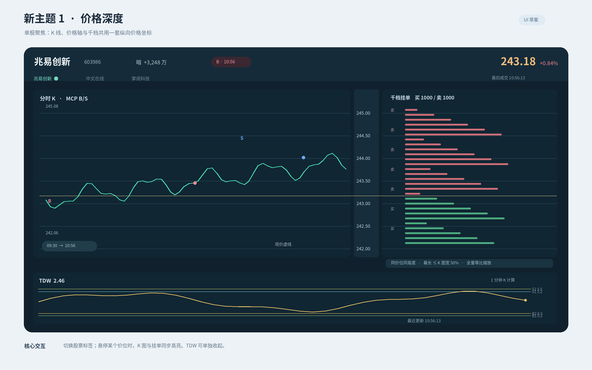
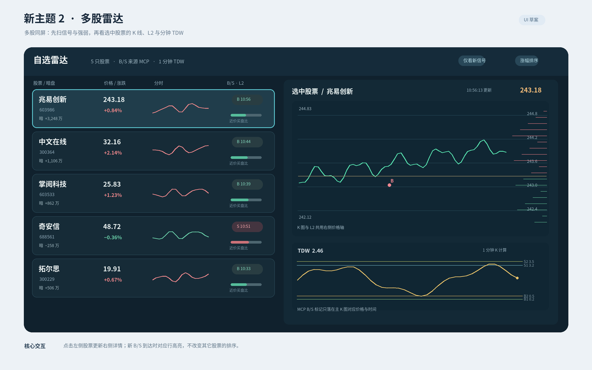

# 两个新主题：UI 设计稿

> 2026-11-09 更新：下方工作台方案已被新的隐蔽悬浮方案取代并完成实现。主题 1 为「一行文字」，主题 2 为「贴边小列」；默认透明底、12 px 灰字、72% 不透明度，悬停临时展开小分时、暗盘与 B/S。字体和透明度可调，保留 Ctrl+F2 一键隐藏。实际渲染见 [紧凑悬浮主题](../docs/stealth-themes.png)。以下保留为历史设计记录。

本设计接在已选定的设置页 **方案 A（侧栏工作台）** 后。两张图均为静态 UI 提案，行情与时间是示意数据；目前未修改桌面组件或设置页运行代码。

| | 新主题 1：价格深度 | 新主题 2：多股雷达 |
| --- | --- | --- |
| 主要用途 | 聚焦一只股票的价格与逐价位挂单 | 同屏扫描多只股票，再看选中股票详情 |
| 主视图 | 左侧大 K 图、中间共用价格轴、右侧独立千档 | 左侧自选行列表、右侧选中股票 K 图与千档 |
| B/S | MCP B/S 锚定成交时间与 K 图价格 | 列表显示最近信号，右侧 K 图精确标记 |
| TDW | 下方独立副图，按 1 分钟 OHLC 计算 | 仅在右侧选中股票详情展示 1 分钟 TDW |
| 最佳窗口 | 较宽、较高的单股观察窗口 | 适合五只以上自选股的宽屏列表 |

## 主题 1：价格深度

顶部可切换股票标签。K 图与右侧挂单按同一价格坐标绘制，鼠标悬停价位时两侧同步高亮。当前价在共用价格轴上，横向虚线延伸到两侧。挂单条最长不超过 K 图绘图区宽度的 50%；当可用空间缩小时，全部价位等比例收缩，绝不截断或合并档位。下方 TDW 可单独收起。

## 主题 2：多股雷达

左侧每行显示名称、现价、涨跌幅、暗盘、微型分时、最新 B/S 与近价挂单买盘占比；点击行后右侧展示完整 K 图、逐价位挂单和分钟 TDW。新 B/S 到达时高亮对应股票，默认保持自选顺序；“涨幅排序”是用户主动启用的视图。近价挂单比只表示当前可见价位的委买量相对占比，不代表成交资金或交易建议。

## 设置页 A 的导航与配置归属

- **公共设置**：自选股票、行情与 K 线数据源、刷新间隔、MCP 接入和通知。三个主题共用。
- **主题设置**：主题 3“分时＋TDW”以及两个新主题各自保存窗口尺寸、图表开关、字体、颜色和透明度。
- **选择主题**：三张卡片显示当前启用项；旧主题 1/2 不再出现。旧配置须能读取并迁移，避免现有用户启动失败。
- **预览**：主题选择及常用图表参数在同一页调整，右侧预览跟随变化。

落地前需确认两个主题的布局和信息密度。后续实现应分别验证窄窗口、透明背景、价轴与挂单逐价位对齐、MCP B/S 实际落点、1 分钟 TDW 与窗口拖拽缩放。
