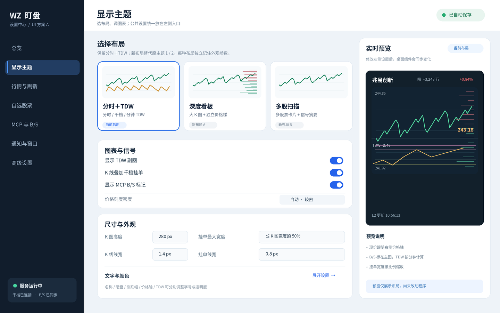
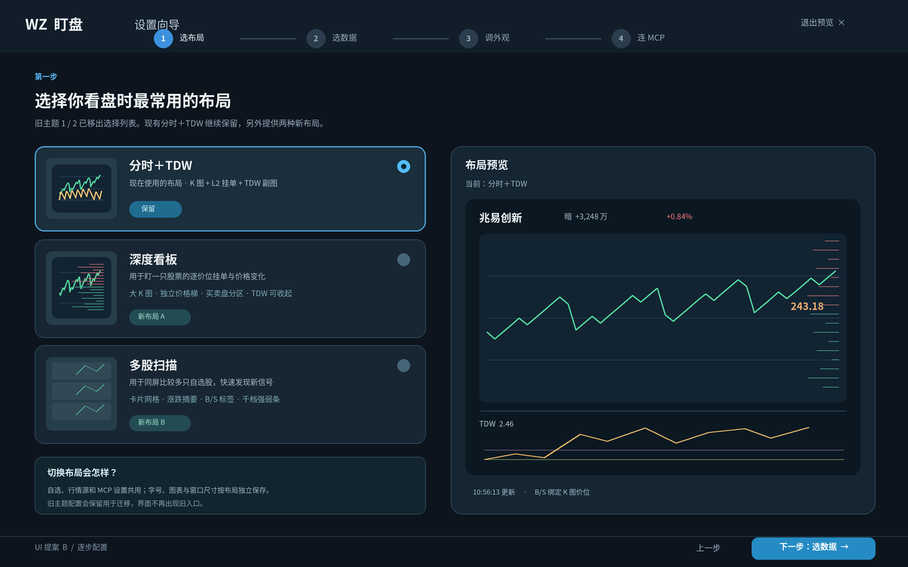

# 设置页重设计：两套 UI 提案

已选定 **方案 A：侧栏工作台**。当前阶段仅交付界面预览，不修改运行中的设置页、主题枚举或配置格式。两个新主题的详细预览见 [new-themes.md](new-themes.md)。

## 共同的内容结构

| 区域 | 新设置页呈现 | 来源 |
| --- | --- | --- |
| 布局 | 分时＋TDW、深度看板、多股扫描 | 保留当前主题 3；后两者是替代原主题 1/2 的新方案 |
| 公共 | 行情源、K 线源、刷新间隔、自选、MCP 连接与通知 | 跨布局共用 |
| 各布局独立 | 字号、颜色、透明度、窗口尺寸、K 线高度、TDW、挂单线宽与开关 | 选定布局后编辑 |
| 实时预览 | 股票名、暗盘、涨跌幅同排；现价在右轴；B/S 在 K 图；TDW 是 1 分钟指标 | 与现有主题 3 的最新行为保持一致 |

预览里的股票、数字和连接状态均是设计示例。新布局的功能需要选定 UI 后实现。

## 方案 A：侧栏工作台

左侧按任务导航，中央直接选择布局和调整常用图表参数，右侧固定实时预览。适合经常微调千档、线宽、透明度的使用场景。首次进入直接展示当前布局；高级参数按组展开。数据源、自选和 MCP 在独立导航项中编辑。

## 方案 B：逐步配置

分成“选布局 → 选数据 → 调外观 → 连 MCP”四步，先用大预览确认布局，再配置该布局参数。适合第一次配置或重新整理大量设置时使用。完成后仍可从步骤条直接回到任一部分。

## 两个替代布局的定位

- **深度看板**：一只股票的大 K 图、独立价格梯与买卖盘分区，重点观察逐价位挂单；TDW 可收起。
- **多股扫描**：多只自选股票卡片，突出涨跌摘要、B/S 标签与千档强弱，重点快速比较与发现新信号。

旧主题 1/2 的入口从新设置页移除。实施阶段需要保留旧配置的迁移读取能力，避免已有配置导致启动失败；旧布局何时彻底删除应与新布局的实现一起处理。

## 选型建议

优先采用 **方案 A**：当前使用场景是频繁调整图表和千档，常用开关与预览同屏能减少跳转。方案 B 更适合安装向导，但平时修改一个参数要跨步骤。
